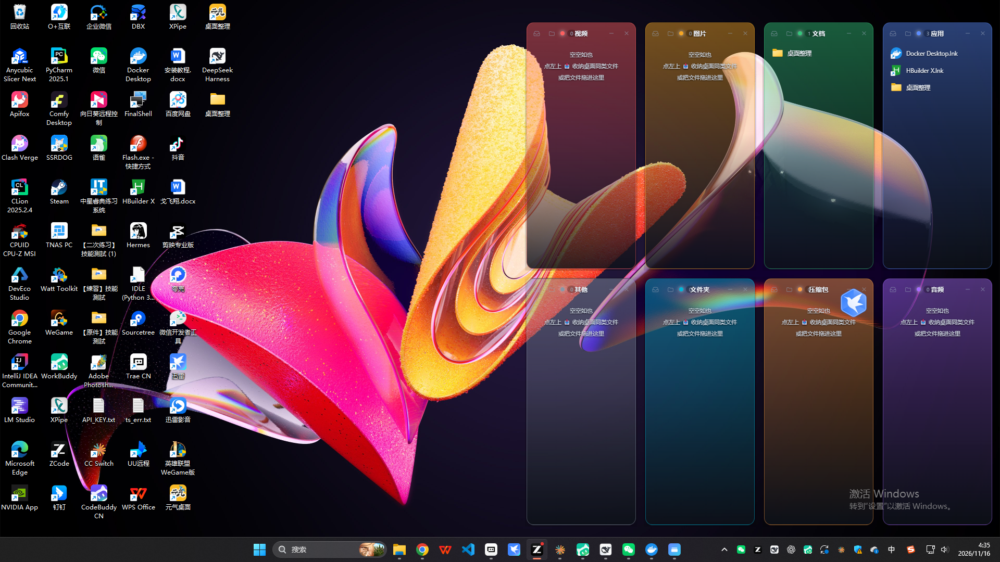

# PureDesk · 桌面收纳

<p align="center">
  <a href="README.md">简体中文</a> ·
  <a href="#english">English</a>
</p>

<p align="center">
  
</p>

<p align="center">
  <b>轻量、纯净、本地的 Windows 桌面整理工具</b><br>
  Tauri 2 (Rust) + 原生 TypeScript · 无广告 · 无账号 · 无联网 · 单进程 ~10MB 内存
</p>

---

把桌面图标拖进彩色的「收纳盒」，文件真实归位到 `桌面\桌面整理\<分类>` 文件夹。
关掉软件文件也不会丢，资源管理器随时可用 —— **盒子只是文件的漂亮入口**。

## ✨ 功能

| | |
| --- | --- |
| 🗂 **桌面收纳盒** | 每个分类一个无边框、半透明、按分类染色的小窗，永久钉在桌面层（窗口之下、壁纸之上）。可拖动、双击收起/展开、把文件直接拖进来 |
| ⚡ **一键整理** | 按扩展名规则把桌面文件归入对应盒子；收纳文件夹可选择自动隐藏（设置开关，退出时自动恢复可见），桌面真正干净；失败逐条报告真实原因 |
| 🗑 **管理文件** | 盒内右键：重命名 / 删除（进系统回收站，可还原）/ 移入其他盒子 / 还原到桌面 |
| 🤖 **自动整理**（可选） | 监听桌面目录，新文件自动归位；内置 8 秒保护期，绝不搬走正在写入的文件 |
| ➕ **自定义盒子** | 任意新建/命名/配色/删除自己的分组（工作、开发、娱乐…），手动策展快捷方式与文件；重命名后文件自动跟随 |
| ↩️ **还原到桌面** | 盒内文件右键还原；自动绕过自动整理 6 秒防止被搬回 |
| 🚫 **排除规则** | 每行一条、支持 `*` `?` 通配；内置下载临时文件排除 |
| 🔍 **快速搜索** | 主面板搜索桌面与所有盒子内容 |
| 📌 **托盘常驻** | 关闭行为可选：最小化到托盘 / 结束进程；全局快捷键 `Ctrl+Alt+G` 一键整理、`Ctrl+Alt+D` 显示/隐藏 |
| 🔒 **纯本地** | 无账号、无联网、无遥测。配置是本地 JSON，收纳是普通文件夹 |

## 📦 安装

### 从源码构建（当前版本请自行构建）

```bash
git clone <repo-url> puredesk
cd puredesk
npm install
npm run tauri build          # 产物: src-tauri/target/release/puredesk.exe (+ NSIS 安装包)
```

> Windows 10 1809+ / Windows 11，需要 Node 18+ 与 Rust stable（MSVC）。
> 若本机没有 WebView2 Runtime，安装包/单文件会提示用微软在线引导程序安装（`webviewInstallMode: downloadBootstrapper`）。

**给 Windows 上的贡献者**：在低完整性令牌环境（例如某些沙箱/IDE 终端）里构建出的 exe 会被打上
`Low Mandatory Level` 标签，启动后写不了桌面。修复：管理员或普通 PowerShell 执行
`icacls <exe 所在目录>\puredesk.exe /setintegritylevel M`（`scripts/install.ps1` 已内置此步骤）。

### 直接运行

构建产物是**绿色单文件**（约 7MB），放到任意目录双击即可，配置与缓存生成在 `%APPDATA%\com.puredesk.app`
（或 exe 同目录，视可写性自动选择）。启动问题排查：exe 同目录下的 `puredesk.log`。

## 🚀 使用

1. 启动后桌面右侧出现默认「收纳盒」（v0.2.1 单盒模型：预设分类默认停用，在「设置 → 盒子与分类」里可随时重新启用并显示其盒子窗口）
2. 把桌面图标**拖进盒子**，或点主面板 ⚡ 一键整理（预设分类启用时，盒子左上角 📥 可只收纳该分类的同类文件）
3. 在设置里新建自己的分组（如「工作」「开发」），自由策展；勾选扩展名则该盒参与自动归类，留空为纯手动盒
4. 右键盒内文件：打开 / 移入其他盒子 / 还原到桌面；多选（Ctrl/Shift+点）后底部出现批量操作栏

## ❓ 常见问题

**Q: 双击 exe 弹出「Windows 已保护你的电脑」？**
未签名应用的正常提示，点「更多信息 → 仍要运行」即可。想彻底消除：
- 管理员 PowerShell 执行 `Set-ItemProperty "HKLM:\SOFTWARE\Microsoft\Windows\CurrentVersion\Explorer" -Name SmartScreenEnabled -Value "Off"`（关闭资源管理器的应用信誉检查），或
- 在 Windows 安全中心 → 基于声誉的保护中调整，或使用受信任的代码签名证书。

**Q: 启动后无法写入桌面 / 收纳失败提示拒绝访问？**
若你是通过 SmartScreen「仍要运行」启动的，进程会继承**低完整性令牌**（Windows 安全机制），无权写入桌面。v0.2.1 起应用会在主面板顶部自动提示。解决：按上面关闭 SmartScreen 检查后重启应用；或在设置中把「收纳存储位置」改到非桌面路径。

**Q: 桌面上那个「桌面整理」文件夹是什么？**
收纳文件的真实存放处（普通文件夹，资源管理器随时可用）。默认**保持可见**（关软件后桌面快捷方式仍可直接双击使用）；想让桌面更干净可在设置里勾选「隐藏桌面上的收纳文件夹」，应用退出时会自动恢复可见。

**Q: 会把我的文件弄丢吗？**
不会。收纳 = 移动到普通文件夹（重名自动改名为「名字 (2)」；被占用的文件自动重试，仍失败则逐条报告、绝不做删除）；还原操作校验路径必须位于收纳区内；删除盒子时盒内文件自动全部还原到桌面。

**Q: 杀毒软件报毒？**
未签名应用的常见误报，加入白名单即可。欢迎在 Release 页核对 SHA-256。

## 🛠 技术栈

- **Rust + Tauri 2**：多窗口、托盘、全局快捷键、文件监听（notify）、Shell 图标提取、自建 OLE 拖放目标
- **原生 TypeScript**：无框架，主面板与收纳盒共用一个 bundle（js ≈ 16KB gzip / css ≈ 4KB gzip）
- 配置：单个 JSON 文件（`%APPDATA%\com.puredesk.app\config.json`，便携模式可用 `PUREDESK_CONFIG` 重定向）

```
src-tauri/src/
├── lib.rs        应用装配：托盘 / 窗口事件（置底钉住）/ 关闭行为 / WebView2 数据目录降级
├── config.rs     配置模型 + 默认分类规则（便携 / AppData / exe 同级三级落盘）
├── scan.rs       桌面扫描、分类匹配、通配排除
├── organize.rs   整理引擎（冲突改名、保护期、互斥、单盒迁移）
├── boxwin.rs     收纳盒窗口生命周期
├── droptarget.rs 自建 OLE IDropTarget（绕过 WebView2 注入时序问题）
├── watcher.rs    桌面监听 + 去抖自动整理
├── icons.rs      Shell 图标 → PNG（带缓存）
├── logging.rs    文件日志 + panic 钩子（写不了 exe 目录时降级 TEMP/用户目录）
├── state.rs      全局状态：配置读写锁、移动互斥、图标缓存
└── winutil.rs    已知文件夹 / HWND_BOTTOM 钉底 / 隐藏属性
```

## 🗺 Roadmap

- [ ] QuickLook 式空格预览
- [ ] Everything 集成搜索
- [ ] 自动整理规则预览（dry-run）
- [ ] 多显示器拓扑变化时盒子位置恢复
- [x] 盒子内多选与批量操作（Ctrl/Shift 多选 + 底部批量栏：删除/移入其他盒/还原）

## 🛠 开发

```bash
# 开发（vite dev server + tauri 热重载）
npm run tauri dev

# 单元测试（整理引擎 / 扫描 / 通配匹配 / 配置迁移）
cd src-tauri && cargo test

# 静态检查
cd src-tauri && cargo clippy --all-targets

# 前端类型检查 + 产物构建
npm run build
```

> Windows 沙箱环境提示：若构建目录被标记为 `Low Mandatory Level`，`cargo test`
> 里 `tempfile::tempdir()`（落在系统 TEMP）会拒绝访问。可把 `TMP`/`TEMP` 指到一个
> Medium 完整性、可写的目录再跑；发布构建不受影响。

## 📜 脚本说明

| 脚本 | 用途 | 权限 |
| --- | --- | --- |
| `scripts/install.ps1` | 把 release exe 装到 `%LOCALAPPDATA%\Programs\PureDesk`、修完整性标签、建桌面快捷方式；`-ScheduledTask` 才注册计划任务（默认不注册） | 普通用户 |
| `scripts/fix-smartscreen.ps1` | 自动定位本机 exe：清网络标记、修 Low 标签、打印各候选位置的日志；`-QuietAllSmartScreen` 才改全局 SmartScreen（需管理员，默认不执行） | 普通用户 / 可选管理员 |
| `scripts/gen-icon.mjs` | 重新生成 `assets/icon.png`（零依赖手写 PNG 编码） | 无 |
| `scripts/drag-experiment.ps1` | 开发者调试用：模拟鼠标把桌面图标拖进盒子，验证 OLE 拖放链路 | 开发 |

## 📌 更新记录

- **v0.2.1**（当前）
  - 修复：低完整性令牌（SmartScreen「仍要运行」）下启动崩溃 —— WebView 数据目录与日志均改为「可写才用」逐级降级
  - 修复：收纳移动失败时复制+删除兜底路径可能误覆盖同名目标（现加存在性校验，宁报错不覆盖）
  - 修复：内置预设分类（含默认「收纳盒」）此前可被误删，现在不可删、可停用/隐藏；用户自定义盒仍可删（文件自动还原）
  - 增强：盒子窗口创建失败不再是启动级故障，主面板可一键「重建盒子窗口」
  - 新增：盒子内多选（Ctrl/Shift）+ 批量删除 / 移入其他盒 / 还原
  - 清理：发布前安全清理（本地签名私钥不入库）、脚本安全化（计划任务与全局 SmartScreen 修改均改为显式 opt-in）

## 🙏 致谢

设计与交互参考了同类开源项目的优秀实践：[DeskBox](https://github.com/Tianyu199509/DeskBox)、[desktop-organizer 主题下的各项目](https://github.com/topics/desktop-organizer)。

## 📄 License

[MIT](LICENSE)

---

<a name="english"></a>

# PureDesk (EN)

A lightweight, privacy-first desktop organizer for Windows. Drag desktop icons into color-tinted floating boxes pinned to your desktop layer; files are physically organized into `Desktop\Desktop Organized\<category>` folders that keep working even with the app closed.

**Highlights**: persistent desktop widgets · one-click & auto organize · user-defined boxes · tray with configurable close behavior · global hotkeys · zero network, zero telemetry.

Built with **Tauri 2 (Rust)** + vanilla **TypeScript**. See the Chinese section above for full docs — the model is simple: boxes are pretty front-ends for plain folders.
