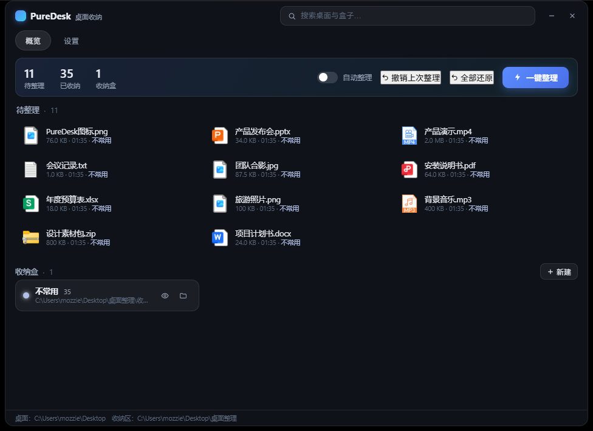
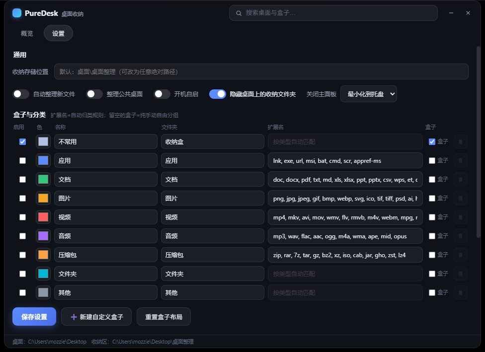
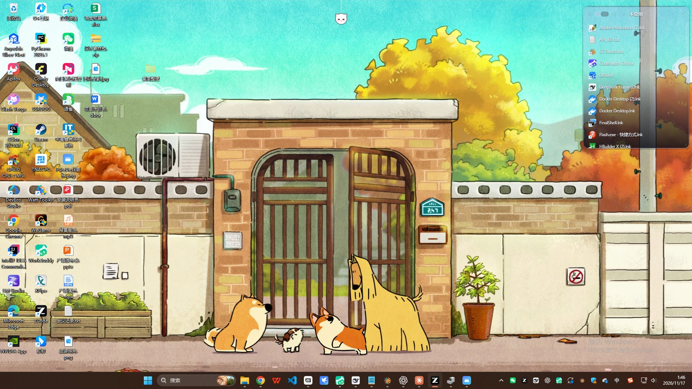
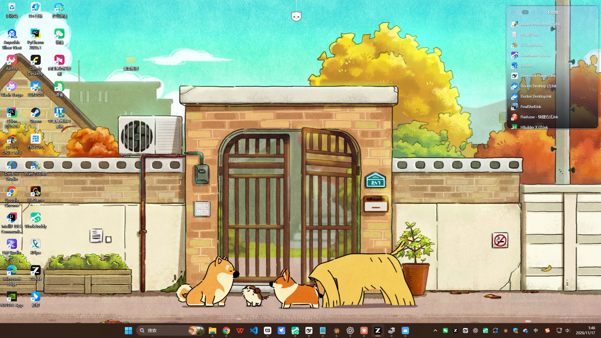

# PureDesk · 桌面收纳

<p align="center">
  <a href="https://github.com/CDThings/puredesk/releases/latest"></a>
  <a href="https://github.com/CDThings/puredesk/actions/workflows/build.yml"></a>
  <a href="https://github.com/CDThings/puredesk/releases"></a>
  
  <a href="LICENSE"></a>
</p>

<p align="center">
  <a href="README.md">简体中文</a> ·
  <a href="#english">English</a>
</p>

<p align="center">
  
</p>

<p align="center">
  <b>轻量、纯净、本地的 Windows 桌面整理工具</b><br>
  Tauri 2 (Rust) + 原生 TypeScript · 无广告 · 无账号 · 无联网 · 单进程 ~10MB 内存
</p>

---

把桌面图标拖进彩色的「收纳盒」，文件真实归位到 `桌面\桌面整理\<分类>` 文件夹。
关掉软件文件也不会丢，资源管理器随时可用 —— **盒子只是文件的漂亮入口**。
手滑了？**「撤销上次整理」一键反悔**；想全部搬回来？**「全部还原」一步到位**。

**目录**：[功能](#-功能) · [界面速览](#-界面速览) · [安装](#-安装) · [快速上手教程](#-快速上手教程) · [常见问题](#-常见问题) · [技术栈](#-技术栈) · [开发指南](#-开发) · [脚本说明](#-脚本说明) · [更新记录](#-更新记录) · [English](#english)

## ✨ 功能

| | |
| --- | --- |
| 🏝 **收纳岛** | 屏幕顶部常驻的灵动岛式状态胶囊：平时收起只显示计数，悬停展开分类明细与快捷操作（一键整理/撤销/全部还原），整理到达时播放活动动画 |
| 🗂 **桌面收纳盒** | 每个分类一个无边框、半透明、按分类染色的小窗，永久钉在桌面层（窗口之下、壁纸之上）。可拖动、双击收起/展开、把文件直接拖进来 |
| ⚡ **一键整理** | 按扩展名规则把桌面文件归入对应盒子；收纳文件夹可选择自动隐藏（设置开关，退出时自动恢复可见），桌面真正干净；失败逐条报告真实原因 |
| 🗑 **管理文件** | 盒内右键：重命名 / 删除（进系统回收站，可还原）/ 移入其他盒子 / 还原到桌面 |
| 🤖 **自动整理**（可选） | 监听桌面目录，新文件自动归位；内置 8 秒保护期，绝不搬走正在写入的文件 |
| ➕ **自定义盒子** | 任意新建/命名/配色/删除自己的分组（工作、开发、娱乐…），手动策展快捷方式与文件；重命名后文件自动跟随 |
| ↩️ **还原到桌面** | 盒内文件右键还原；主面板「全部还原」一键把所有盒子内容放回桌面；自动绕过自动整理 6 秒防止被搬回 |
| ⏪ **撤销上次整理** | 每次收纳移动记入移动日志（moves.jsonl，保留最近 50 批），一键反向搬回原位；原位被占用时自动改名放回，绝不覆盖 |
| 🩹 **自愈与防护** | 启动时自动清理「目录被搬进自身子树」产生的嵌套骨架（历史事故自愈）；移动前硬性拒绝自环目标；junction/软链接一律不参与扫描、整理与复制，杜绝成环路径；复制内置 128 层保险丝 |
| 🛡 **环境自检** | 低完整性令牌、桌面被 OneDrive/网盘重定向等高危环境启动即给出明确指引横幅 |
| 🚫 **排除规则** | 每行一条、支持 `*` `?` 通配；内置下载临时文件排除 |
| 🔍 **快速搜索** | 主面板搜索桌面与所有盒子内容 |
| 📌 **托盘常驻** | 关闭行为可选：最小化到托盘 / 结束进程；全局快捷键 `Ctrl+Alt+G` 一键整理、`Ctrl+Alt+D` 显示/隐藏 |
| 🔒 **纯本地** | 无账号、无联网、无遥测。配置是本地 JSON，收纳是普通文件夹 |

## 🖼 界面速览

**主面板 · 概览**（`Ctrl+Alt+D` 随时唤出）：待整理 / 已收纳 / 盒子统计，一键整理、撤销、全部还原都在手边。

**设置页**：扩展名规则、排除通配、收纳位置、自启与关闭行为，全部一个 JSON 的可视化表单。

| 主面板 | 设置页 |
| --- | --- |
|  |  |

**桌面整理前后**：文件物理归入收纳文件夹（可自动隐藏），桌面只留半透明收纳盒。

| 整理前 | 整理后 |
| --- | --- |
|  |  |

## 📦 安装

### 方式一：下载安装包（推荐，普通用户）

1. 打开 [GitHub Releases](../../releases/latest) 页面；
2. 下载 `PureDesk_vX.Y.Z_x64-setup.exe`（安装版，带开始菜单与卸载器）或 `PureDesk_vX.Y.Z_x64_portable.zip`（便携版，解压即用）；
3. 安装包若遇 SmartScreen 提示「Windows 已保护你的电脑」：点 **更多信息 → 仍要运行**（应用未做付费代码签名，属正常提示；发布页附有 `SHA256SUMS.txt` 可自行核对哈希）。

### 方式二：包管理器（规划中）

- `winget install PureDesk`（manifest 提交进行中）
- Scoop bucket（规划中）

### 方式三：从源码构建（开发者）

```bash
git clone https://github.com/CDThings/puredesk.git puredesk
cd puredesk
npm install
npm run tauri build          # 产物: src-tauri/target/release/puredesk.exe (+ NSIS 安装包)
```

> Windows 10 1809+ / Windows 11，需要 Node 18+ 与 Rust stable（MSVC）。
> 若本机没有 WebView2 Runtime，安装包/单文件会提示用微软在线引导程序安装（`webviewInstallMode: downloadBootstrapper`）。

**给 Windows 上的贡献者**：在低完整性令牌环境（例如某些沙箱/IDE 终端）里构建出的 exe 会被打上
`Low Mandatory Level` 标签，启动后写不了桌面。修复：管理员或普通 PowerShell 执行
`icacls <exe 所在目录>\puredesk.exe /setintegritylevel M`（`scripts/install.ps1` 已内置此步骤）。

### 方式三补充：直接运行构建产物

构建产物是**绿色单文件**（约 7MB），放到任意目录双击即可，配置与缓存生成在 `%APPDATA%\com.puredesk.app`
（或 exe 同目录，视可写性自动选择）。启动问题排查：exe 同目录下的 `puredesk.log`。

## 🚀 使用

1. 启动后桌面右侧出现默认「收纳盒」（v0.2.1 单盒模型：预设分类默认停用，在「设置 → 盒子与分类」里可随时重新启用并显示其盒子窗口）
2. 把桌面图标**拖进盒子**，或点主面板 ⚡ 一键整理（预设分类启用时，盒子左上角 📥 可只收纳该分类的同类文件）
3. 在设置里新建自己的分组（如「工作」「开发」），自由策展；勾选扩展名则该盒参与自动归类，留空为纯手动盒
4. 右键盒内文件：打开 / 移入其他盒子 / 还原到桌面；多选（Ctrl/Shift+点）后底部出现批量操作栏

## 🎓 快速上手教程

下面按「第一次使用」的顺序，带你从安装到把桌面收拾干净。

### 第一步：安装并启动

- **从源码构建**：见上方[安装](#-安装)。构建完成后得到 `src-tauri/target/release/puredesk.exe`。
- **安装到本机**（推荐，绿色单文件 + 桌面快捷方式）：
  ```powershell
  # 在仓库根目录运行；默认装到 %LOCALAPPDATA%\Programs\PureDesk
  powershell -ExecutionPolicy Bypass -File scripts\install.ps1
  ```
  脚本会：关闭运行中的实例 → 复制到安装目录 → 清除网络标记并修正完整性标签 → 建桌面快捷方式。装完桌面就有一个「PureDesk」图标，双击启动。
- 若构建/安装环境打上了低完整性标签、启动后提示写不了桌面，跑一次：
  ```powershell
  powershell -ExecutionPolicy Bypass -File scripts\fix-smartscreen.ps1
  ```
  它会自动定位 exe、清标记、修标签并打印各位置的日志，无需管理员即可处理绝大多数情况。

### 第二步：认识界面

- **主面板**：点托盘图标或按 `Ctrl+Alt+D` 唤出。左侧「概览」页显示待整理数量、已收纳数量、盒子列表与「一键整理」按钮。
- **收纳盒**：桌面右侧的半透明彩色小窗。每个盒子钉在桌面层（图标之上、所有窗口之下），双击顶栏可收起/展开，右下角手柄可拖拽调大小。
- **设置页**：主面板顶部「设置」标签，管理盒子与分类、扩展名规则、排除规则、收纳位置、自动整理开关。

### 第三步：把桌面文件收进盒子

三种方式，任选：

1. **拖拽**：直接用鼠标把桌面图标拖进某个盒子，文件立即归位到该盒对应的文件夹。
2. **一键整理**：点主面板 ⚡「一键整理」，按扩展名规则把桌面全部文件归类到对应盒子。
3. **盒子内收纳同类**：点盒子左上角 📥，只把「桌面上属于此分类」的文件收进来（预设分类启用时可用）。

整理完成后，桌面只留盒子，文件真实存放在 `桌面\桌面整理\<分类>`。关掉软件文件也不会丢。

> **反悔通道**：主面板 **⏪ 撤销上次整理** 把最近一批移动反向搬回原位（原位被占用时自动改名放回，绝不覆盖）；**↩️ 全部还原** 把所有盒子里的内容放回桌面根目录。托盘右键菜单里也有同样的入口。

### 第四步：管理盒内文件

- **右键单个文件**：打开 / 在资源管理器显示 / 重命名 / 移入其他盒 / 还原到桌面 / 删除（进回收站，可还原）。
- **多选**：`Ctrl+点击` 累加、`Shift+点击` 连选。选中 ≥1 项时，盒子底部浮出批量操作栏，可整批删除、移入其他盒、还原。
- **还原到桌面**：把文件搬回桌面；自动抑制自动整理 6 秒，避免刚还原的文件被立刻搬回去。

### 第五步：建立自己的分类

- 点主面板「新建」或「设置 → 新建自定义盒子」。
- 给盒子起名（如「工作」「开发」），可勾选扩展名预设（文档/图片/视频…）。**勾了扩展名的盒会自动收纳桌面同类文件；留空则是纯手动盒**（只靠你拖拽/移入）。
- 在「设置 → 盒子与分类」里可改每个盒的名称、文件夹名、颜色、启停、是否显示盒子窗口。**重命名文件夹后，盒内文件会自动跟随迁移**，不会丢。

### 第六步（可选）：自动整理

- 打开主面板或设置里的「自动整理」开关。
- 之后桌面有新文件落地，PureDesk 监听桌面目录、静默 0.9 秒去抖后自动归类。内置 **8 秒新文件保护期**，正在写入/刚下载的文件不会被搬走。

### 第七步（可选）：开机自启 & 全局快捷键

- 「设置」勾选「开机自启」。
- 全局快捷键（任意界面可用）：`Ctrl+Alt+G` 一键整理；`Ctrl+Alt+D` 显示/隐藏主面板。
- 关闭主面板时可选「最小化到托盘」或「结束进程」。

### 小贴士

- **想让桌面彻底干净**：设置里勾选「隐藏桌面上的收纳文件夹」（应用退出时自动恢复可见，桌面快捷方式始终可用）。
- **收纳位置**：默认 `桌面\桌面整理`。可在「收纳存储位置」改成任意绝对路径（如 `E:\PureDesk`），盒子与文件仍照常工作。
- **搜文件**：主面板顶部搜索框可搜桌面 + 所有盒子内容，按名称过滤。
- **改图标大小**：盒子顶栏的 +/- 按钮调整图标基准尺寸（18–64px）。

## ❓ 常见问题

**Q: 双击 exe 弹出「Windows 已保护你的电脑」？**
未签名应用的正常提示，点「更多信息 → 仍要运行」即可。想彻底消除：
- 管理员 PowerShell 执行 `Set-ItemProperty "HKLM:\SOFTWARE\Microsoft\Windows\CurrentVersion\Explorer" -Name SmartScreenEnabled -Value "Off"`（关闭资源管理器的应用信誉检查），或
- 在 Windows 安全中心 → 基于声誉的保护中调整，或使用受信任的代码签名证书。

**Q: 启动后无法写入桌面 / 收纳失败提示拒绝访问？**
若你是通过 SmartScreen「仍要运行」启动的，进程会继承**低完整性令牌**（Windows 安全机制），无权写入桌面。v0.2.1 起应用会在主面板顶部自动提示。解决：按上面关闭 SmartScreen 检查后重启应用；或在设置中把「收纳存储位置」改到非桌面路径。

**Q: 桌面上那个「桌面整理」文件夹是什么？**
收纳文件的真实存放处（普通文件夹，资源管理器随时可用）。默认**保持可见**（关软件后桌面快捷方式仍可直接双击使用）；想让桌面更干净可在设置里勾选「隐藏桌面上的收纳文件夹」，应用退出时会自动恢复可见。

**Q: 会把我的文件弄丢吗？**
不会。收纳 = 移动到普通文件夹（重名自动改名为「名字 (2)」；被占用的文件自动重试，仍失败则逐条报告、绝不做删除）；还原操作校验路径必须位于收纳区内；删除盒子时盒内文件自动全部还原到桌面。**移动前还有防自环硬保护**：拒绝把目录搬进它自己的子树（历史上某些整理工具因此产生过无法删除的无限嵌套目录，PureDesk 从引擎层杜绝），junction/软链接不参与整理，复制内置 128 层深度保险丝。

**Q: 整理错了 / 想反悔怎么办？**
主面板「撤销上次整理」把最近一批移动搬回原位（保留最近 50 批记录）；「全部还原」把所有盒子内容放回桌面。删盒子也会先自动还原盒内文件。

**Q: 启动时提示「桌面已被 OneDrive / 网盘重定向」？**
你的桌面路径被 OneDrive「桌面备份」等网盘功能接管了（`C:\Users\<你>\OneDrive\Desktop`）。整理类软件与网盘同步共存容易互相搬文件。建议：OneDrive 设置 → 同步和备份 → 管理备份 → 停止「桌面」备份，把桌面恢复到本机路径后再使用自动整理；或把收纳存储位置改到非桌面路径。

**Q: 卸载 PureDesk 会删我的文件吗？**
不会。卸载只移除程序本身；收纳文件夹 `桌面\桌面整理` 里的文件原样保留（它们只是被移动过的普通文件）。卸载前建议先用「全部还原」把文件放回桌面原位。

**Q: 杀毒软件报毒？**
未签名应用的常见误报，加入白名单即可。欢迎在 Release 页核对 SHA-256。

## 🛠 技术栈

- **Rust + Tauri 2**：多窗口、托盘、全局快捷键、文件监听（notify）、Shell 图标提取、自建 OLE 拖放目标
- **原生 TypeScript**：无框架，主面板与收纳盒共用一个 bundle（js ≈ 16KB gzip / css ≈ 4KB gzip）
- 配置：单个 JSON 文件（`%APPDATA%\com.puredesk.app\config.json`，便携模式可用 `PUREDESK_CONFIG` 重定向）

```
src-tauri/src/
├── lib.rs        应用装配：托盘 / 窗口事件（置底钉住）/ 关闭行为 / WebView2 数据目录降级
├── config.rs     配置模型 + 默认分类规则（便携 / AppData / exe 同级三级落盘）
├── scan.rs       桌面扫描、分类匹配、通配排除
├── organize.rs   整理引擎（冲突改名、保护期、互斥、单盒迁移）
├── boxwin.rs     收纳盒窗口生命周期
├── droptarget.rs 自建 OLE IDropTarget（绕过 WebView2 注入时序问题）
├── watcher.rs    桌面监听 + 去抖自动整理
├── icons.rs      Shell 图标 → PNG（带缓存）
├── logging.rs    文件日志 + panic 钩子（写不了 exe 目录时降级 TEMP/用户目录）
├── state.rs      全局状态：配置读写锁、移动互斥、图标缓存
└── winutil.rs    已知文件夹 / HWND_BOTTOM 钉底 / 隐藏属性
```

## 🗺 Roadmap

- [ ] 整理前预览确认（dry-run：先看将怎么分，再执行）
- [ ] 整理报告面板（逐条 from → to 与失败原因，不只 toast）
- [ ] 自动整理稳定态保护期（60 秒无写入才搬移，替代固定 8 秒）
- [ ] 自动更新（tauri-plugin-updater，签名 + latest.json）
- [ ] 双击桌面空白处隐藏/显示图标（可关、防误触）
- [ ] 多显示器拓扑变化时盒子位置恢复
- [ ] 映射文件夹盒子（盒子直接映射任意现有文件夹，免搬移）
- [ ] Everything `es.exe` 集成搜索
- [x] 盒子内多选与批量操作（Ctrl/Shift 多选 + 底部批量栏：删除/移入其他盒/还原）
- [x] 移动日志 + 撤销上次整理 / 全部还原（v0.2.2）
- [x] 启动自愈：嵌套骨架清理 + 防自环 + junction 隔离（v0.2.2）
- [x] OneDrive 桌面重定向检测横幅（v0.2.2）
- [x] 收纳岛：屏幕顶部灵动岛式状态胶囊（常驻显示收纳/待整理计数，悬停展开收纳区全貌与快捷操作，整理完成时播放活动动画）

> 发布工程（安装包 CI、签名策略、官网下载页、winget 上架）见 [docs/release-plan.md](docs/release-plan.md)。

## 🛠 开发

### 环境准备

| 依赖 | 用途 | 获取 |
| --- | --- | --- |
| Node 18+ | 前端（vite + TypeScript） | https://nodejs.org |
| Rust stable (MSVC) | 后端（Tauri 2） | https://rustup.rs，选 `msvc` 工具链 |
| WebView2 Runtime | 承载 UI | Win10 1809+/Win11 自带，或 https://developer.microsoft.com/microsoft-edge/webview2 |
| Visual Studio Build Tools | Rust MSVC 编译 | 安装时勾选「使用 C++ 的桌面开发」 |

> 首次 `cargo` 命令会自动下载并编译 Tauri 全家桶（几分钟，正常）。

### 常用命令

```bash
# 1) 安装前端依赖
npm install

# 2) 开发模式（vite dev server + 热重载；改前端秒级生效，改 Rust 重新编译）
npm run tauri dev

# 3) 发布构建（先 tsc+vite 打包前端，再 cargo release；产物在 src-tauri/target/release/）
npm run tauri build

# 4) 只跑 Rust 单元测试（整理引擎 / 扫描 / 通配匹配 / 配置迁移）
cd src-tauri && cargo test

# 5) 静态检查（clippy，目标 0 警告）
cd src-tauri && cargo clippy --all-targets

# 6) 前端类型检查 + 产物构建（不进 Rust）
npm run build
```

### 新增一个后端命令的典型流程

1. 在 `src-tauri/src/commands.rs` 写 `#[tauri::command] pub fn my_cmd(app: AppHandle, ...) -> Result<...>`。
2. 在 `lib.rs` 的 `tauri::generate_handler![ ... ]` 列表里注册该命令。
3. 前端 `src/api.ts` 里加 `myCmd: (...) => invoke("my_cmd", {...})`（参数名 camelCase）。
4. 需要新权限时改 `src-tauri/capabilities/default.json`。
5. `cargo clippy` + `cargo test` + `npm run build` 全绿。

> 命令入参在前端是 **camelCase**，Rust 侧自动映射为 snake_case（如 `boxId` → `box_id`）。

### 跑测试的沙箱注意

> 若构建目录被标记为 `Low Mandatory Level`（某些 IDE/沙箱终端会这样），`cargo test` 里
> `tempfile::tempdir()`（落在系统 TEMP）会拒绝访问。把 `TMP`/`TEMP` 指到一个
> Medium 完整性、可写的目录再跑即可；发布构建不受影响。

## 📜 脚本说明

| 脚本 | 用途 | 权限 |
| --- | --- | --- |
| `scripts/install.ps1` | 把 release exe 装到 `%LOCALAPPDATA%\Programs\PureDesk`、修完整性标签、建桌面快捷方式；`-ScheduledTask` 才注册计划任务（默认不注册） | 普通用户 |
| `scripts/fix-smartscreen.ps1` | 自动定位本机 exe：清网络标记、修 Low 标签、打印各候选位置的日志；`-QuietAllSmartScreen` 才改全局 SmartScreen（需管理员，默认不执行） | 普通用户 / 可选管理员 |
| `scripts/gen-icon.mjs` | 重新生成 `assets/icon.png`（零依赖手写 PNG 编码） | 无 |
| `scripts/drag-experiment.ps1` | 开发者调试用：模拟鼠标把桌面图标拖进盒子，验证 OLE 拖放链路 | 开发 |

## 📌 更新记录

> 完整更新日志见 [CHANGELOG.md](CHANGELOG.md)；每次发布（含安装包与校验和）见 [Releases](https://github.com/CDThings/puredesk/releases)。

- **v0.3.0**（当前）
  - 新增「🏝 收纳岛」：顶部灵动岛式状态胶囊——收起态计数徽章、悬停展开明细与快捷操作（一键整理/撤销/全部还原/打开收纳夹）、整理活动动画（设置页可开关，托盘可显隐）
  - 新增创意池 `docs/IDEAS.md`：每日维护流程沉淀产品创意（12 条，含价值/可行性/优先级）
- **v0.2.2**
  - **修复严重缺陷：无限递归目录**。此前把目录搬进它自身子树的移动请求在 rename 失败后会走「复制+删除」兜底，复制无环检测 → 源目录被不断复制进自身（实测产生 306 层嵌套空目录，资源管理器无法删除也无法看到底部）。现在：`move_path` 移动前硬性拒绝「目标位于源内部」（含 canonicalize 与字符串双重判定），`copy_dir_recursive` 增加 128 层深度保险丝 + 子树内自环拒绝
  - **新增「撤销上次整理」**：所有收纳移动按批次写入移动日志（配置目录 `moves.jsonl`，保留最近 50 批），主面板/命令一键反向搬回最近一批；原位被占用自动改名放回
  - **新增「全部还原」**：主面板与托盘「一键还原桌面」，把所有启用盒子的内容放回桌面根目录
  - **新增启动自愈**：自动检测并清理分类文件夹里与存储根同名的嵌套目录——空骨架直接删除；含真实文件的副本搬到桌面交还用户，绝不误删数据
  - **加固扫描**：junction/软链接（reparse point）一律不参与扫描、整理与复制，防止成环路径进入收纳流
  - **新增 OneDrive 重定向检测**：桌面被网盘接管（KFM）时主面板显示风险横幅与恢复指引（整理类软件最大翻车源）
  - 测试：19 项单元测试全覆盖上述场景（含 junction 跳过、自环拒绝、自愈清理、撤销批次）

- **v0.2.1**
  - 修复：低完整性令牌（SmartScreen「仍要运行」）下启动崩溃 —— WebView 数据目录与日志均改为「可写才用」逐级降级
  - 修复：收纳移动失败时复制+删除兜底路径可能误覆盖同名目标（现加存在性校验，宁报错不覆盖）
  - 修复：内置预设分类（含默认「收纳盒」）此前可被误删，现在不可删、可停用/隐藏；用户自定义盒仍可删（文件自动还原）
  - 增强：盒子窗口创建失败不再是启动级故障，主面板可一键「重建盒子窗口」
  - 新增：盒子内多选（Ctrl/Shift）+ 批量删除 / 移入其他盒 / 还原
  - 清理：发布前安全清理（本地签名私钥不入库）、脚本安全化（计划任务与全局 SmartScreen 修改均改为显式 opt-in）

## 🙏 致谢

设计与交互参考了同类开源项目的优秀实践：[DeskBox](https://github.com/Tianyu199509/DeskBox)、[desktop-organizer 主题下的各项目](https://github.com/topics/desktop-organizer)。

## 📄 License

[MIT](LICENSE)

---

<a name="english"></a>

# PureDesk (EN)

A lightweight, privacy-first desktop organizer for Windows. Drag desktop icons into color-tinted floating boxes pinned to your desktop layer; files are physically organized into `Desktop\Desktop Organized\<category>` folders that keep working even with the app closed.

**Highlights**: persistent desktop widgets · one-click & auto organize · user-defined boxes · tray with configurable close behavior · global hotkeys · zero network, zero telemetry.

Built with **Tauri 2 (Rust)** + vanilla **TypeScript**. See the Chinese section above for full docs — the model is simple: boxes are pretty front-ends for plain folders.
